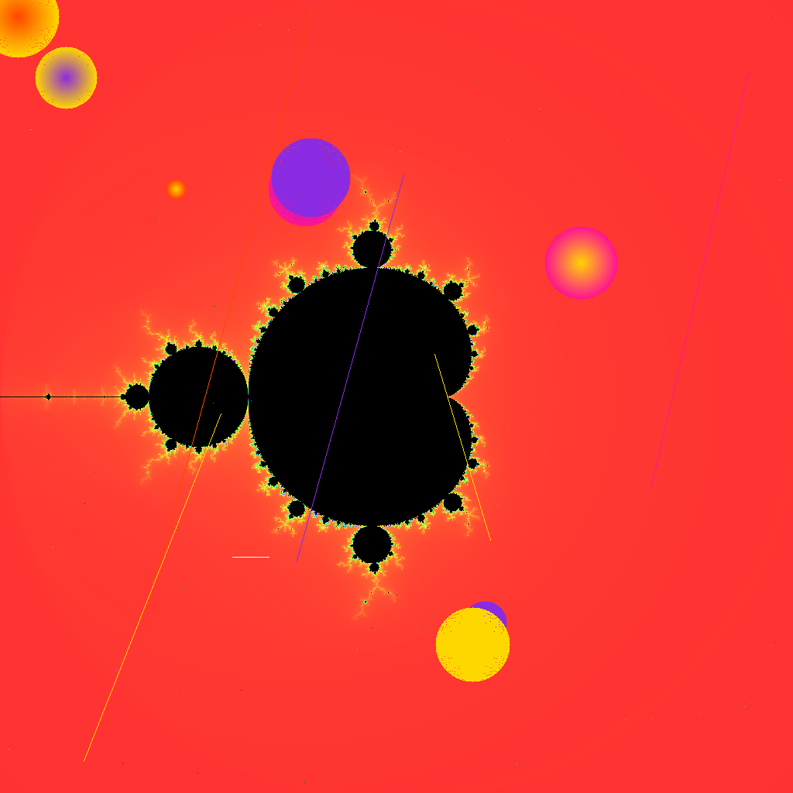

# 🎸 FractPunk

## Cyber-Fractal Chaos

FractPunk is a generative art engine that fuses mathematical beauty with punk-inspired rebellion.  
It creates Mandelbrot and Julia set fractals with chaotic overlays, producing unique, abstract visuals every time.

## ✨ Features

- Fractal Generation 🌀  
  - Supports both Mandelbrot and Julia sets, randomly selected on each run.
  - Uses smooth gradient coloring for a vivid look.

- Artistic Overlays 🎨  
  - Gradient Circles → Color-fading geometric forms  
  - Variable-Opacity Sparkles → Subtle glowing effects  
  - Chaotic Lines → Sharp, abstract linework  
  - Dynamic Annotations → Randomized text injections (`"Fnord!"`, `"Kallisti!"`, `"5 Tons of Flax"`, etc.)

- Automated Image Generation 📸  
  - Images are automatically saved with unique filenames.
  - Output is high-resolution (1024x1024).

## 🖼 Example Output



---

## Usage

1. Install Go: [Download and Install Go](https://go.dev/doc/install)
2. Clone the repository:

   ```bash
   git clone https://github.com/TFMV/FractPunk.git
   cd FractPunk
   ```

3. Run the program:

   ```bash
   go mod tidy
   go run main.go
   ```

## License

This project is licensed under the MIT License. See the [LICENSE](LICENSE) file for details.
